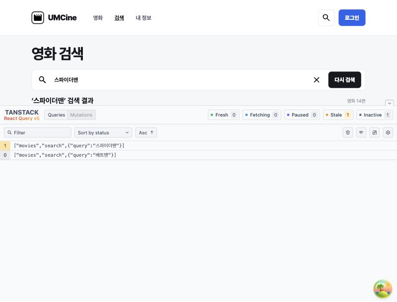

# 6주차 미션 기록: 영화 화면에 TanStack Query 적용하기

## 한 일

목록, 검색, 상세 페이지의 `useEffect` 요청과 로딩, 오류 상태를 `useQuery`로 바꿨어요. 화면 UI는 그대로 유지했어요.

| 화면 | query key |
|---|---|
| 목록 | `["movies", "list", { page }]` |
| 검색 | `["movies", "search", { query: normalizedQuery }]` |
| 상세 | `["movies", "detail", movieId]` |

## 고민한 부분

- `enabled`가 `false`면 `isPending`이 계속 `true`라서, 상세 페이지는 잘못된 번호를 로딩보다 먼저 확인해요.
- 없는 영화도 4번 요청해 오류가 약 8초 늦게 보였어요. 그래서 404는 재시도하지 않게 했어요.

## 확인 결과

- **상태 표시:** 세 화면 모두 로딩, 오류, 성공 상태가 나오고, 목록과 검색은 빈 결과도 표시돼요.
- **cache 재사용:** 다시 연 화면은 로딩 문구 없이 바로 보여요. `staleTime`이 기본값 0이라 백그라운드 요청은 한 번씩 나가요.
- **Query 개발자 도구:** 검색어마다 키가 따로 생기고, 쓰는 쿼리는 Stale, 안 쓰는 쿼리는 Inactive로 보여요.

