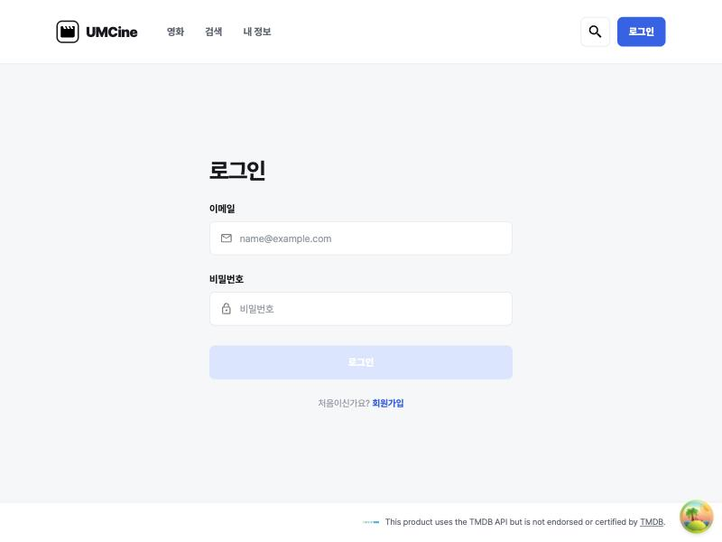
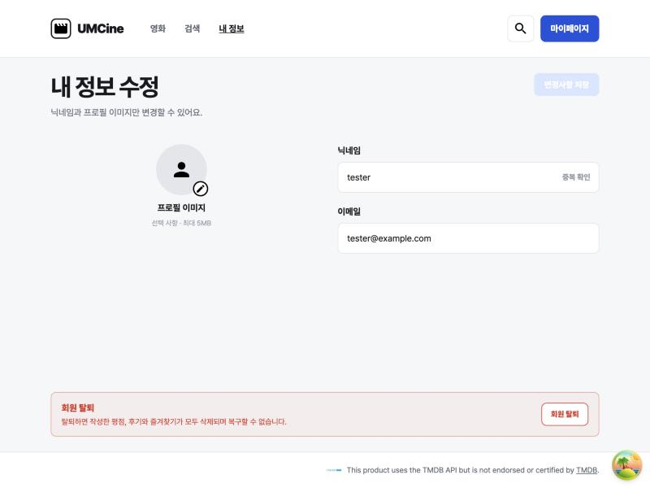
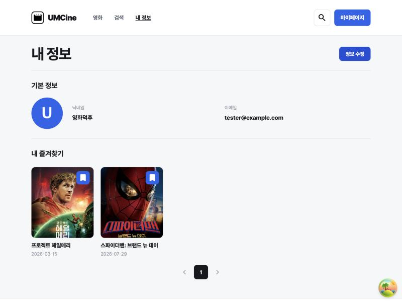

# 7주차 미션 기록: 로그인과 내 정보 화면 퍼블리싱하기

## 한 일

Figma 디자인에 맞춰 로그인, 내 정보, 내 정보 수정 화면을 만들었어요. 로그인 API가 아직 없어서 로그인 상태는 zustand 스토어(`auth-store`)에 저장해요.

| 경로 | 화면 |
|---|---|
| `/login` | 이메일과 비밀번호를 입력해요. 둘 다 올바르게 입력해야 로그인 버튼이 활성화돼요. |
| `/profile` | 프로필 이미지, 닉네임, 이메일과 즐겨찾기한 영화를 보여줘요. |
| `/profile/edit` | 프로필 이미지와 닉네임을 바꾸고, 회원 탈퇴를 할 수 있어요. |

- **헤더:** 로그인하면 오른쪽 버튼이 `로그인`에서 `마이페이지`로 바뀌어요.
- **로그인 확인:** 로그인하지 않고 `/profile`에 들어가면 `/login`으로 이동해요.

## 고민한 부분

- **즐겨찾기 목록:** 저장된 영화 ID로 상세 정보를 `useQueries`로 불러와요. 영화 상세 페이지와 같은 query key를 써서 cache를 함께 사용해요.
- **영화 카드 재사용:** 상세 응답에는 `genre_ids`가 없어서, 영화 카드가 목록 응답 타입 대신 공통 타입(`TmdbMovie`)을 받도록 바꿨어요.
- **닉네임 변경:** 닉네임을 바꾸면 서버 API로 중복 확인을 통과해야 저장할 수 있어요.
- **프로필 이미지:** 이미지는 localStorage에 넣기엔 커서 저장하지 않아요. 그래서 새로고침하면 기본 아이콘으로 돌아가요.

## 확인 결과

- **로그인:** 입력한 이메일이 내 정보에 표시되고, 닉네임은 이메일 앞부분으로 채워져요.
- **정보 수정:** 닉네임과 이미지를 바꿔 저장하면 내 정보에 바로 반영돼요. 새로고침해도 닉네임은 유지돼요.
- **즐겨찾기:** 영화 목록에서 즐겨찾기한 영화가 내 정보에 표시돼요.
- **회원 탈퇴:** 탈퇴하면 로그인 상태와 즐겨찾기가 지워지고 홈으로 이동해요.

